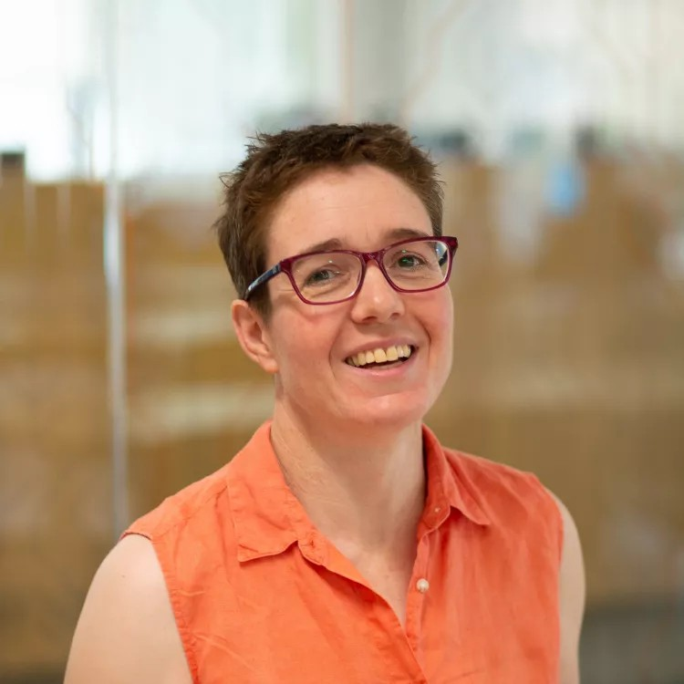

  

    

      <h2 class="text-white">Machine Learning Reproducibility Challenge</h2>
      <h3 class="text-white">NeurIPS 2026 Reproducibility Track</h3>
      <h4 class="text-white">Dec 2026, Sydney, Australia</h4>
    

  

## MLRC 2026

Welcome to the home of ML Reproducibility Challenge. This is an annual event
promoting research into reproducibility of Machine Learning literature.
([v1](https://www.cs.mcgill.ca/~jpineau/ICLR2018-ReproducibilityChallenge.html),
[v2](https://www.cs.mcgill.ca/~jpineau/ICLR2019-ReproducibilityChallenge.html),
[v3](https://reproducibility-challenge.github.io/neurips2019/),
[v4](https://paperswithcode.com/rc2020),
[v5](https://paperswithcode.com/rc2021),
[v6](https://paperswithcode.com/rc2022), [v7](/proceedings/mlrc2023/), [v8](/mlrc2025/)). This
conference is a unique venue in the Machine Learning community to share,
disseminate and discuss reproducible methods and tools, investigate
reproducibility of papers accepted for publication at top conferences, and test
generalizability of scientific findings by adding novel insights and empirical
results.

{}

- :bell: The 16 accepted papers for MLRC 2026 are announced! See the [Accepted Papers](#accepted-papers) below, and join us at the poster session on **Thursday, December 10, 2026, at 5:00-8:00 PM** Sydney time.
- :bell: [December 10th NeurIPS Reproducibility Track](#agenda) is now live, with invited talks by Bin Yu, Liming Zhu, Pin-Yu Chen, and Charlotte Deane (remote, tentative).
- :bell: Submissions for MLRC 2026 are now closed (the hard deadline was September 30, 2026). Thank you to everyone who submitted!
- :bell: MLRC 2026 will be an official track at [NeurIPS 2026](https://neurips.cc/Conferences/2026/CallForReproducibility)! Check out our [Call for Papers](/call_for_papers) for more details.

{}

## Accepted Papers

We are delighted to announce the 16 papers accepted to the Machine Learning Reproducibility Challenge (MLRC) 2026, an official track of NeurIPS 2026. The papers will be presented in person at NeurIPS 2026 in Sydney, Australia (December 6–13, 2026), alongside papers from the Main Track and the Evaluations & Datasets Track. Each paper was first accepted at the Transactions on Machine Learning Research (TMLR), and subsequently underwent a light compatibility review by the MLRC committee to confirm its suitability for the track ([NeurIPS Blog](https://blog.neurips.cc/2026/11/04/mlrc-2026-announcing-the-accepted-papers/)).

The MLRC poster session will be held on **Thursday, December 10, 2026, at 5:00-8:00 PM** Sydney time. We invite all attendees to visit the poster presentations, meet the authors, and engage in discussion with them.

### Accepted Papers from the Transactions on Machine Learning Research (TMLR)

1. [A Reproduction Study of Weight-Based Mechanistic Interpretability in Bilinear MLPs](https://openreview.net/forum?id=6k7qRdz7rD)
   Itay Erlich, May Ben Zion, Jacob Shashoua (**Outstanding Paper Award**)
2. [Auditing Closed-Loop Learning in Recurrent Neural Networks: Reproduction, Robustness, and Generalization](https://openreview.net/forum?id=e0pSqIqwXO)
   Aarav Sinha
3. [[Re] Boosting the Visual Interpretability of CLIP via Adversarial Fine-Tuning](https://openreview.net/forum?id=uPXRBZfkYy)
   Anton Nuzhdin, Andrei Gruzitski, Balázs Egyed, Aleksandr Raudvee
4. [Evaluating the evidence trace of NeurIPS 2025 contributions with agentic code auditing](https://openreview.net/forum?id=xjCJY8Xxcm)
   Pascal Iversen, Ferdous Nasri, Bernhard Y. Renard, Katharina Baum (**Best Paper Award**)
5. [[Re] FairDICE: A Fair Tradeoff in Multi-objective Offline RL](https://openreview.net/forum?id=Tr6MBt0hAj)
   Peter Adema, Karim Galliamov, Aleksey Evstratovskiy, Ross Geurts
6. [Min-p, Max Exaggeration: A Critical Analysis of Min-p Sampling in Language Models](https://openreview.net/forum?id=rCupWGkP6W)
   Rylan Schaeffer, Joshua Kazdan, Yegor Denisov-Blanch (**Outstanding Paper Award**)
7. [Opening Up a New Layer: A Deeper Look into "Interpreting CLIP with Hierarchical Sparse Autoencoders"](https://openreview.net/forum?id=l0qZkSk2aH)
   Nora Kahleogullari, Ada Romanowski, Mathan Sundarrajan, Sally Veerman
8. [Reproducibility study of "Bilinear MLPs enable weight-based mechanistic interpretability"](https://openreview.net/forum?id=Bnx3hf3mWp)
   Hamid Reza Ahmadi, Mihnea Andrei Bârsan, Jan Jelínek, Robert-Ștefan Sofroni
9. [Reproducibility study of FACTER: Fairness-Aware Conformal Thresholding and Prompt Engineering](https://openreview.net/forum?id=vX5mPaLdeQ)
   Elena Belkina, Alexandra Elena Antonica, Brigitta Varga, Mattia Sferrazza, Clara Rus
10. [Reproducing FACTER: Fairness via Conformal Thresholding and Prompt Repair](https://openreview.net/forum?id=4BPFVex4EM)
   Oscar Miró López-Feliu, Daimy van Loo, Xanthos Kekkos, Mikel Blom, Clara Rus
11. [Revisiting "Edit Away and My Face Will not Stay: Personal Biometric Defense against Malicious Generative Editing"](https://openreview.net/forum?id=5Q1gr80AXU)
   Luis Vitor Zerkowski, Soham Chaudhuri, Finley Helms, Jelle Sombekke, Udit Thakur
12. [Revisiting B2T: Discovering and Mitigating Visual Biases through Keyword Explanations](https://openreview.net/forum?id=5GS1q65pv6)
   Faissal El Kayouhi, Aïda Asma, Joey Laarhoven, Fiona Nagelhout
13. [Revisiting RegressionMSR: A Reproducibility Study](https://openreview.net/forum?id=AzOk6sdMRZ)
   Neev Mistry
14. [Stable Continuous-Time Consistency Distillation: An Empirical Study with a Multistep Extension](https://openreview.net/forum?id=di6ofoWEU8)
   Vinay Saji Mathew, Soundar Kumara, Gretta Kellogg, William KM Lai
15. [WAREX: Web Agent Reliability Evaluation on Existing Benchmarks](https://openreview.net/forum?id=o4pXVP8RCD)
   Su Kara, Fazle Faisal, Suman Nath
16. [XFeat Revisited: Reproducibility and Evaluation of a Lightweight Image Matcher](https://openreview.net/forum?id=2WI889Ulin)
   Lazar Đoković, Aimee Lin

## Agenda

The TMLR session will take place on **Thursday, December 10, 2026, in Room C3.2**, starting at 9:00 AM, followed by the poster session in the evening.

### Invited Speakers

<a href="https://binyu.stat.berkeley.edu">Bin Yu</a>

UC Berkeley

Reproducible AI Workflows with Veridical Data Science

<a href="https://www.pinyuchen.com">Pin-Yu Chen</a>

IBM Research

vLLM Hook: Towards Runtime Monitoring and Control on AI Inference Engines

<a href="https://www.unsw.edu.au/staff/liming-zhu">Liming Zhu</a>

CSIRO Data61 and UNSW

Reproducibility in AI Research: When AI Is Also the Researcher

<a href="https://www.stats.ox.ac.uk/people/charlotte-deane">Charlotte Deane</a>

University of Oxford

Tentative remote talk, title to be announced

<table style="width:100%;border-collapse:collapse;font-size:0.95rem;margin:8px 0 24px 0;">
<thead>
<tr>
<th style="background:#1565c0;color:#fff;text-align:left;padding:10px 12px;border:1px solid #dee2e6;">Time</th>
<th style="background:#1565c0;color:#fff;text-align:left;padding:10px 12px;border:1px solid #dee2e6;">Session</th>
</tr>
</thead>
<tbody>
<tr>
<td style="white-space:nowrap;font-weight:600;padding:10px 12px;border:1px solid #dee2e6;vertical-align:top;">9:00-9:10 AM</td>
<td style="padding:10px 12px;border:1px solid #dee2e6;vertical-align:top;">Opening Remarks</td>
</tr>
<tr style="background:#f8f9fa;color:#212529;">
<td style="white-space:nowrap;font-weight:600;padding:10px 12px;border:1px solid #dee2e6;vertical-align:top;">9:10-9:45 AM</td>
<td style="padding:10px 12px;border:1px solid #dee2e6;vertical-align:top;">Invited Talk (remote, Tentative): Charlotte Deane (University of Oxford) — title to be announced (30 min talk + 5 min Q&A)</td>
</tr>
<tr>
<td style="white-space:nowrap;font-weight:600;padding:10px 12px;border:1px solid #dee2e6;vertical-align:top;">9:45-10:05 AM</td>
<td style="padding:10px 12px;border:1px solid #dee2e6;vertical-align:top;">Spotlight 1 (15 min talk + 5 min Q&A): <em>"Evaluating the evidence trace of NeurIPS 2025 contributions with agentic code auditing"</em> — Pascal Iversen, Ferdous Nasri, Bernhard Y. Renard, Katharina Baum (Best Paper Award)</td>
</tr>
<tr style="background:#f8f9fa;color:#212529;">
<td style="white-space:nowrap;font-weight:600;padding:10px 12px;border:1px solid #dee2e6;vertical-align:top;">10:05-10:40 AM</td>
<td style="padding:10px 12px;border:1px solid #dee2e6;vertical-align:top;">Lightning Talks Block A (7 talks x 5 min)</td>
</tr>
<tr>
<td style="white-space:nowrap;font-weight:600;padding:10px 12px;border:1px solid #dee2e6;vertical-align:top;">10:40-11:10 AM</td>
<td style="padding:10px 12px;border:1px solid #dee2e6;vertical-align:top;">Coffee Break</td>
</tr>
<tr style="background:#f8f9fa;color:#212529;">
<td style="white-space:nowrap;font-weight:600;padding:10px 12px;border:1px solid #dee2e6;vertical-align:top;">11:10-11:30 AM</td>
<td style="padding:10px 12px;border:1px solid #dee2e6;vertical-align:top;">Spotlight 2 (15 min talk + 5 min Q&A): <em>"Min-p, Max Exaggeration: A Critical Analysis of Min-p Sampling in Language Models"</em> — Rylan Schaeffer, Joshua Kazdan, Yegor Denisov-Blanch (Outstanding Paper Award)</td>
</tr>
<tr>
<td style="white-space:nowrap;font-weight:600;padding:10px 12px;border:1px solid #dee2e6;vertical-align:top;">11:30 AM-12:00 PM</td>
<td style="padding:10px 12px;border:1px solid #dee2e6;vertical-align:top;">Lightning Talks Block B (6 talks x 5 min)</td>
</tr>
<tr style="background:#f8f9fa;color:#212529;">
<td style="white-space:nowrap;font-weight:600;padding:10px 12px;border:1px solid #dee2e6;vertical-align:top;">12:00-1:30 PM</td>
<td style="padding:10px 12px;border:1px solid #dee2e6;vertical-align:top;">Lunch</td>
</tr>
<tr>
<td style="white-space:nowrap;font-weight:600;padding:10px 12px;border:1px solid #dee2e6;vertical-align:top;">1:30-2:05 PM</td>
<td style="padding:10px 12px;border:1px solid #dee2e6;vertical-align:top;">Invited Talk 1: Bin Yu (UC Berkeley) — <em>"Reproducible AI Workflows with Veridical Data Science"</em> (30 min talk + 5 min Q&A)</td>
</tr>
<tr style="background:#f8f9fa;color:#212529;">
<td style="white-space:nowrap;font-weight:600;padding:10px 12px;border:1px solid #dee2e6;vertical-align:top;">2:05-2:25 PM</td>
<td style="padding:10px 12px;border:1px solid #dee2e6;vertical-align:top;">Spotlight 3 (15 min talk + 5 min Q&A): <em>"A Reproduction Study of Weight-Based Mechanistic Interpretability in Bilinear MLPs"</em> — Itay Erlich, May Ben Zion, Jacob Shashoua (Outstanding Paper Award)</td>
</tr>
<tr>
<td style="white-space:nowrap;font-weight:600;padding:10px 12px;border:1px solid #dee2e6;vertical-align:top;">2:25-2:45 PM</td>
<td style="padding:10px 12px;border:1px solid #dee2e6;vertical-align:top;">Guest Talk (20 min): <a href="https://www.linkedin.com/in/dewei-feng/">Dewei Feng</a> (Meta) — <em>"Who Grades the Reproducers? Teaching Agents to Write Rubrics for ML Paper Reproduction"</em></td>
</tr>
<tr style="background:#f8f9fa;color:#212529;">
<td style="white-space:nowrap;font-weight:600;padding:10px 12px;border:1px solid #dee2e6;vertical-align:top;">2:45-3:05 PM</td>
<td style="padding:10px 12px;border:1px solid #dee2e6;vertical-align:top;">Coffee Break</td>
</tr>
<tr>
<td style="white-space:nowrap;font-weight:600;padding:10px 12px;border:1px solid #dee2e6;vertical-align:top;">3:05-3:40 PM</td>
<td style="padding:10px 12px;border:1px solid #dee2e6;vertical-align:top;">Invited Talk 2: Pin-Yu Chen (IBM Research) — <em>"vLLM Hook: Towards Runtime Monitoring and Control on AI Inference Engines"</em> (30 min talk + 5 min Q&A)</td>
</tr>
<tr style="background:#f8f9fa;color:#212529;">
<td style="white-space:nowrap;font-weight:600;padding:10px 12px;border:1px solid #dee2e6;vertical-align:top;">3:40-4:15 PM</td>
<td style="padding:10px 12px;border:1px solid #dee2e6;vertical-align:top;">Invited Talk 3: Liming Zhu (CSIRO Data61 and UNSW) — <em>"Reproducibility in AI Research: When AI Is Also the Researcher"</em> (30 min talk + 5 min Q&A)</td>
</tr>
<tr>
<td style="white-space:nowrap;font-weight:600;padding:10px 12px;border:1px solid #dee2e6;vertical-align:top;">4:15-4:55 PM</td>
<td style="padding:10px 12px;border:1px solid #dee2e6;vertical-align:top;">Panel Discussion: <em>"Subject, Tool, or Both? Frontier Models and Reproducible Science"</em> — moderated by Koustuv Sinha</td>
</tr>
<tr style="background:#f8f9fa;color:#212529;">
<td style="white-space:nowrap;font-weight:600;padding:10px 12px;border:1px solid #dee2e6;vertical-align:top;">4:55-5:00 PM</td>
<td style="padding:10px 12px;border:1px solid #dee2e6;vertical-align:top;">Closing Remarks</td>
</tr>
<tr>
<td style="white-space:nowrap;font-weight:600;padding:10px 12px;border:1px solid #dee2e6;vertical-align:top;">5:00-8:00 PM</td>
<td style="padding:10px 12px;border:1px solid #dee2e6;vertical-align:top;">Poster Session — Hall 1-4</td>
</tr>
</tbody>
</table>

## Venue

We are excited to announce that MLRC 2026 will be an **official track at [NeurIPS 2026](https://neurips.cc/Conferences/2026)**! This marks the first time MLRC is integrated as a dedicated track within NeurIPS. Accepted papers will be presented at [NeurIPS 2026](https://neurips.cc/Conferences/2026) in **Sydney, Australia**, December 6–13, 2026. As a track within NeurIPS, MLRC is a complementary venue to the Main Track and the Evaluations & Datasets Track.

## Important Dates

- Submit to TMLR OpenReview: [openreview.net/group?id=TMLR](https://openreview.net/group?id=TMLR)
- Earliest date for consideration: **June 21, 2025** 00:00 AOE
- Deadline to share your intent to submit a TMLR paper to MLRC: **June 4, 2026** 23:59 AOE — [submit here](https://forms.gle/bvYxagcRjKSmYhUM7)
- Deadline to have your TMLR decisions in our system: **September 30, 2026** AOE
- Announcement of accepted papers / author notifications: **October 7, 2026**
- [NeurIPS 2026](https://neurips.cc/Conferences/2026): **December 6–13, 2026**, Sydney, Australia

## Organizers

- [Koustuv Sinha](https://koustuvsinha.com), Meta
- [Jessica Forde](https://jzf2101.github.io/), Brown University
- [Ana Lucic](https://a-lucic.github.io/), University of Amsterdam
- [Fernando Pascoal Dos Santos](https://www.uva.nl/en/profile/p/a/f.p.santos/f.p.pascoal-dos-santos.html?cb), University of Amsterdam
- [Candace Ross](https://scholar.google.com/citations?user=vi0aPkoAAAAJ&hl=en), Meta
- [Adina Williams](https://ai.meta.com/people/1396973444287406/adina-williams/), Meta
- [Naila Murray](https://scholar.google.fr/citations?user=suSmYHoAAAAJ&hl=en), Meta
- [Joelle Pineau](https://www.cs.mcgill.ca/~jpineau/), McGill University / Mila / Cohere

## Contact

- For queries related to the conference, or sponsorship requests, please contact us at
  [reproducibility-chairs@neurips.cc](mailto:reproducibility-chairs@neurips.cc)
- Follow us on Social media for updates: Twitter
  ([@repro_challenge](https://x.com/repro_challenge)), BlueSky
  ([@reproml.org](https://bsky.app/profile/reproml.org))
